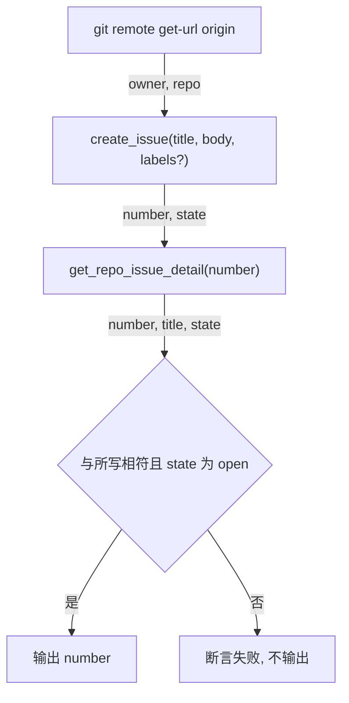
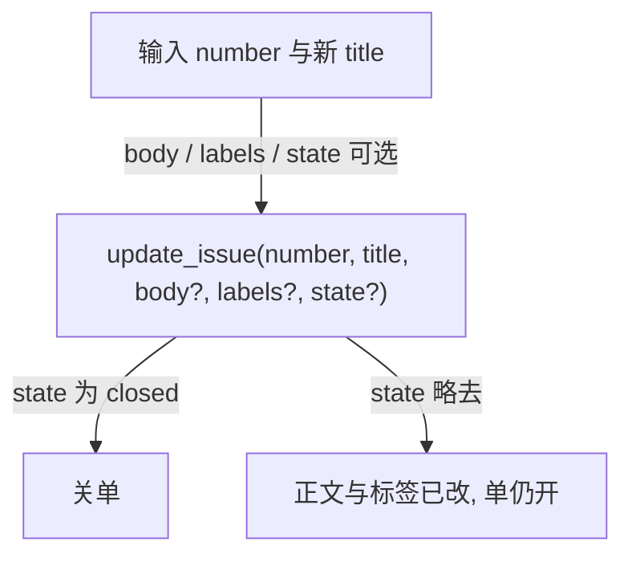
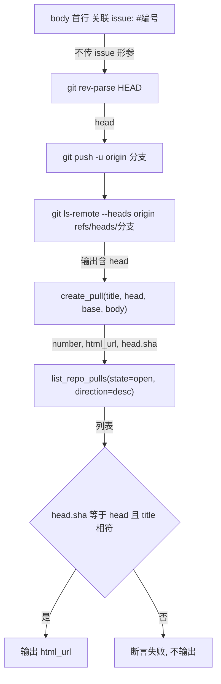
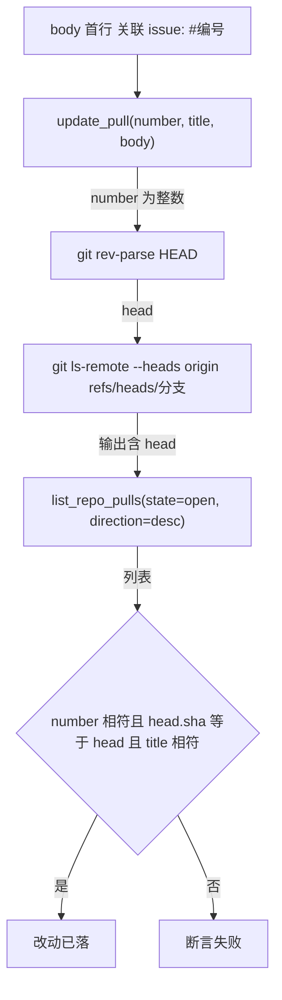

# Gitee issue 与 PR

实测报错原文见 `references/pitfalls.md`。

## 形参

| 形参 | 取值 |
| --- | --- |
| `owner` | 空间地址：个人、组织或企业路径 |
| `repo` | 仓库路径，不带 `owner` |
| `number` | PR 为整数，issue 为字符串（如 `IKSQJK`），两者互不通用 |
| `labels` | 逗号分隔，须已存在于仓库，名字 2–20 字，不确定就不传 |
| `head` | `branch` 或 `path_with_namespace:branch`，跨仓库写 `owner:branch` |
| `body` | Markdown；长文经变量传入，不内联进调用 |

取 `owner`、`repo`：读 `git remote get-url origin`，从末尾两段切出，`https://gitee.com/owner/repo.git` 与 `git@gitee.com:owner/repo.git` 都成立；向 fork 提时改用对应 remote 名，不是 `origin`。

## 建 issue



正文一次写全。体例（缺一节就别写这节，不写空标题）：

```markdown
## 现象
命令、输出原文、复现步骤。

## 成因
表格：文件:行 · 那一行的内容。

## 代价
后果，写成「改这里会牵连 X」。

## 修法
打算改哪一层、改哪几处。

## 验证
判据命令与预期。
```

## 改 issue



`title` 必传。列表查询的形参为 `state`、`sort`、`direction`、`per_page`；大仓传 `state: open`。

## 建 PR



分支存在与否只认 `git ls-remote --heads origin` 的输出，不用 `--dry-run`、`compare_branches_tags`、本地跟踪分支。判据比内容（sha、分支名），不比真值。

## 改 PR



正文写前核一次，写完不读，不为正文另起通道。

## MCP 不可用时走 REST

判据：

- PR 是否已建，按 head 分支查 `GET /repos/<owner>/<repo>/pulls?state=all` 后过滤 `head.ref`，不看 `POST /pulls` 的返回值。
- 令牌能力按端点分：`POST /pulls` 成功而 `POST /issues` 回 `Not Found Project`，是令牌缺 issues 权限，不是仓库名写错。
- 仓库用 squash 合并时，`git branch --merged origin/main` 查不到该分支；改用 `git show origin/main:<被改文件>` 搜改动标记，确认内容已落地。

步骤：

1. 取令牌：`GITEE_TOKEN` 环境变量，查询串写 `access_token=<token>`。
2. 查分支：`GET /repos/<owner>/<repo>/branches/<branch>`；无则先推分支。
3. 查 PR：`GET /repos/<owner>/<repo>/pulls?state=all&per_page=50`，按 `head.ref` 过滤，取 `number`、`html_url`、`state`。
4. 建 PR：`POST /repos/<owner>/<repo>/pulls?access_token=...`，正文写 `title`、`head`、`base`、`body`，头 `Content-Type: application/json; charset=utf-8`。
5. 复核：重取第 3 步，确认该 head 的 PR 数与 `html_url`。

## 合并后清理

1. 主仓 `git worktree remove <path>`，`git worktree list` 复核该路径已消失。
2. `git fetch origin` 后 `git show origin/main:<被改文件>` 搜改动标记，确认合并已落地。
3. `git branch -D <branch>` 删本地分支。
