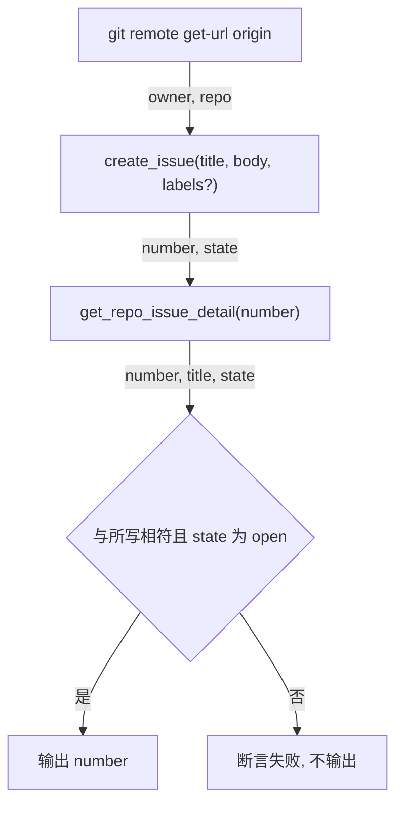
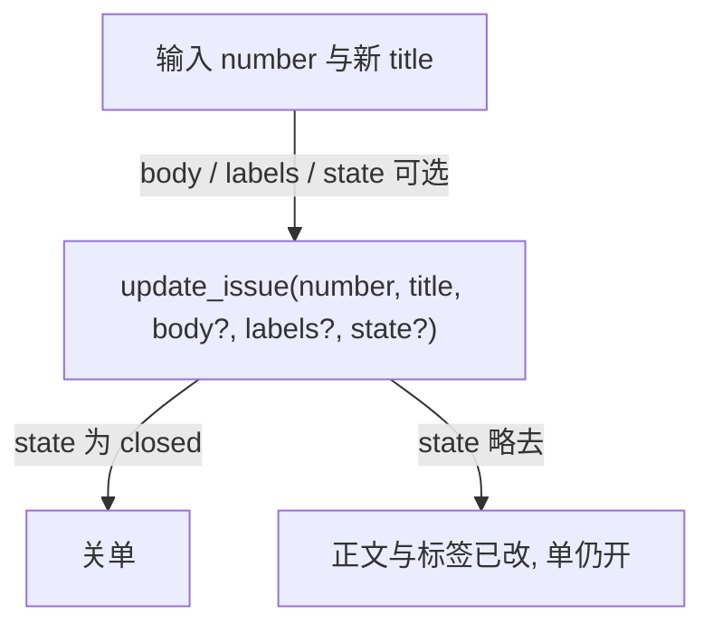
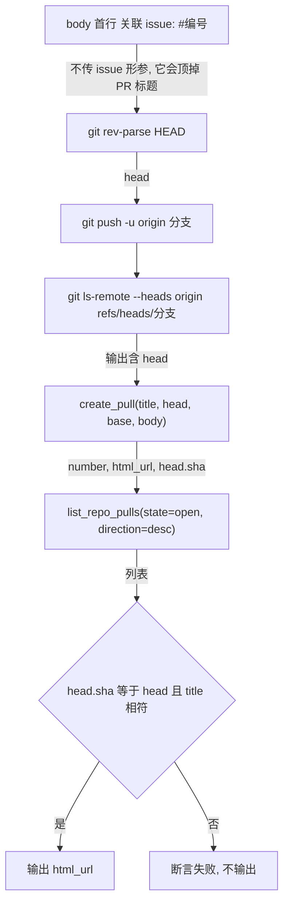
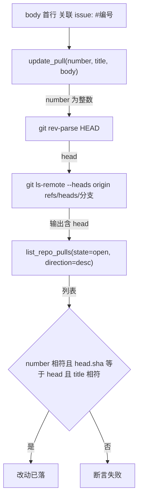

# Gitee issue 与 PR

issue 记现象，PR 带修法，常在同一轮里做。实测报错原文见 `references/pitfalls.md`。

一段流程一个程序：取仓库、写单、回读断言是一条链，链末断言，不拆成多次调用，也不靠人读输出判断。

## 形参

| 形参 | 取值 |
| --- | --- |
| `owner` | 空间地址：个人、组织或企业路径 |
| `repo` | 仓库路径，不带 `owner` |
| `number` | PR 为整数，issue 为字符串（如 `IKSQJK`），两者互不通用 |
| `labels` | 逗号分隔，须已存在于仓库，名字 2–20 字，不确定就不传 |
| `head` | `branch` 或 `path_with_namespace:branch`，跨仓库写 `owner:branch` |
| `body` | Markdown；长文经变量传入，不内联进调用 |

取 `owner`、`repo`：读 `git remote get-url origin`，从末尾两段切出，`https://gitee.com/owner/repo.git` 与 `git@gitee.com:owner/repo.git` 都成立；向 fork 提时改用对应 remote 名，不是 `origin`。

## 建 issue



正文一次写全，不靠事后 `update_issue` 补。体例（缺一节就别写这节，不写空标题）：

```markdown
## 现象
命令、输出原文、复现步骤。

## 成因
表格：文件:行 · 那一行的内容。

## 代价
后果，写成「改这里会牵连 X」。

## 修法
打算改哪一层、改哪几处。

## 验证
判据命令与预期。
```

## 改 issue



`title` 必传，即使只改标签、正文或状态。列表查询的形参为 `state`、`sort`、`direction`、`per_page`；大仓用 `state` 为 open，取全部会超出单次输出上限。

## 建 PR



分支存在与否只有一个判据：`git ls-remote --heads origin`。`--dry-run` 不落远端 ref；`compare_branches_tags` 比的是 tag；PR 合入后远端 ref 常被删，本地跟踪分支仍会列它。

## 改 PR

正文只写不读：`update_pull` 与单条详情都不回 `body`，页面匿名访问被挡。判据落在写入前的本地断言与写入后的 ref 断言上，各一次。



正文对不对，靠写之前核一次；写完不读，因为服务端不回 `body`。为「正文写进去没有」另起通道不产生新读数，且拿占位正文探回执会覆盖刚写好的正文。
